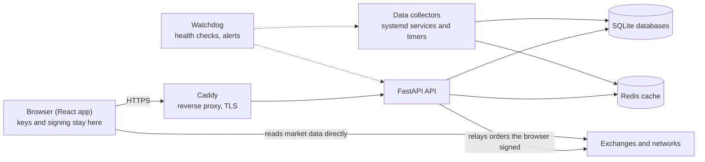

# Illumifi: selected source

[Illumifi](https://illumifi.app) is a live web app for investing and payments. People sign in, hold wallets on several
networks, track a portfolio, send money, and trade spot, futures and prediction markets.

The full codebase is private because it runs a live service that handles real money. This repo shares a few
self-contained pieces of its **client-side security code**, unchanged from production, along with their tests.

## The system at a glance

| | |
|---|---|
| **Backend** | Python 3.12, FastAPI, SQLite (15+ databases with versioned schema migrations), Redis |
| **Frontend** | React 19, TypeScript, Vite |
| **Infrastructure** | 4 Linux servers, 21 systemd services and scheduled jobs, Caddy reverse proxy with automatic HTTPS |
| **Operations** | Test-gated automated deploys, a monitoring watchdog with phone alerts, written runbooks, one-step rollback |
| **Size** | About 150,000 lines of application code and 3,700 automated tests |



The rule behind the whole design: **the server never holds a key that can move a user's money.** It works out
what an order should be, the browser checks it and signs it, and the server only relays the signed result.

## What's in this repo

All code is in [`src/keystore/`](src/keystore).

### 1. One password, two keys ([`masterKey.ts`](src/keystore/masterKey.ts), [`vault.ts`](src/keystore/vault.ts))
The master password never leaves the browser. PBKDF2 (600,000 rounds) turns it into:
- an **AES-GCM vault key** that encrypts the user's wallet keys on the device and can't be read out of JavaScript, and
- a one-way **auth hash** that proves the password to the server without revealing it or the vault key.

The browser also refuses weak settings sent by the server (too few rounds, a short salt), so a server that has
been broken into can't quietly weaken how the password is protected.

### 2. Every wallet from one recovery phrase ([`phrase.ts`](src/keystore/phrase.ts), [`utxo.ts`](src/keystore/utxo.ts), [`phraseBtc.ts`](src/keystore/phraseBtc.ts), [`phraseDoge.ts`](src/keystore/phraseDoge.ts), [`phraseXmr.ts`](src/keystore/phraseXmr.ts), [`xmrAddress.ts`](src/keystore/xmrAddress.ts))
Standard BIP-39 / BIP-32 hierarchical deterministic derivation, so the same 12 words restore the same wallets in
other wallet apps:

| Network | Path | Address |
|---|---|---|
| Ethereum and EVM chains | `m/44'/60'/0'/0/i` | hex |
| Bitcoin | `m/84'/0'/0'/0/i` | native SegWit (bech32) |
| Dogecoin | `m/44'/3'/0'/0/i` | P2PKH (base58check) |
| Monero | `m/44'/128'/i'/0/0` | Monero base58, view key from the spend key |

Monero has no standard way to derive from BIP-39, so this follows the method Cake Wallet and Exodus share. The test
values were cross-checked against Monero's own wallet code. The app also supports Solana and XRP, which aren't
included here because they need large SDKs.

### 3. The browser checks every exchange order before signing it ([`orderCheck.ts`](src/keystore/orderCheck.ts), [`hlAssets.ts`](src/keystore/hlAssets.ts))
The server builds the exact exchange actions for an order. Before signing, the browser checks each one against
what the person asked for: market (read from the exchange directly, not from the server), side, size, price,
leverage, margin type, and that the app's fee is no more than the published rate. Any difference means nothing
is signed. Even a compromised server can't get a device to sign a different trade.

### 4. A trade-only key derived from the owner key ([`hl.ts`](src/keystore/hl.ts))
Orders are signed by a separate key that can trade but can't withdraw or transfer funds. It's derived from the
owner key with HKDF-SHA256, so every device holding the owner key gets the same trading key without any key
being sent anywhere. Renewing moves to the next key number, which retires a key that may have leaked.

## Run the tests

```bash
npm install
npm test           # vitest
npm run typecheck  # strict TypeScript
```

## Notes
- **Excerpts.** Some comments mention files in the private codebase that aren't included here.
- **Test keys are dummy values.** The recovery phrase in the tests is the public BIP-39 test phrase. None of them hold funds.
- **No home-made cryptography.** Hashing, curves and key derivation come from audited libraries
  ([`@noble`](https://github.com/paulmillr/noble-hashes), [`@scure`](https://github.com/paulmillr/scure-bip32),
  [`viem`](https://viem.sh)) and the browser's built-in WebCrypto. This code combines them correctly for each network.
- Built with AI-assisted development (Claude Code).

Copyright © 2026 John Tabb. All rights reserved. Shared for review.
